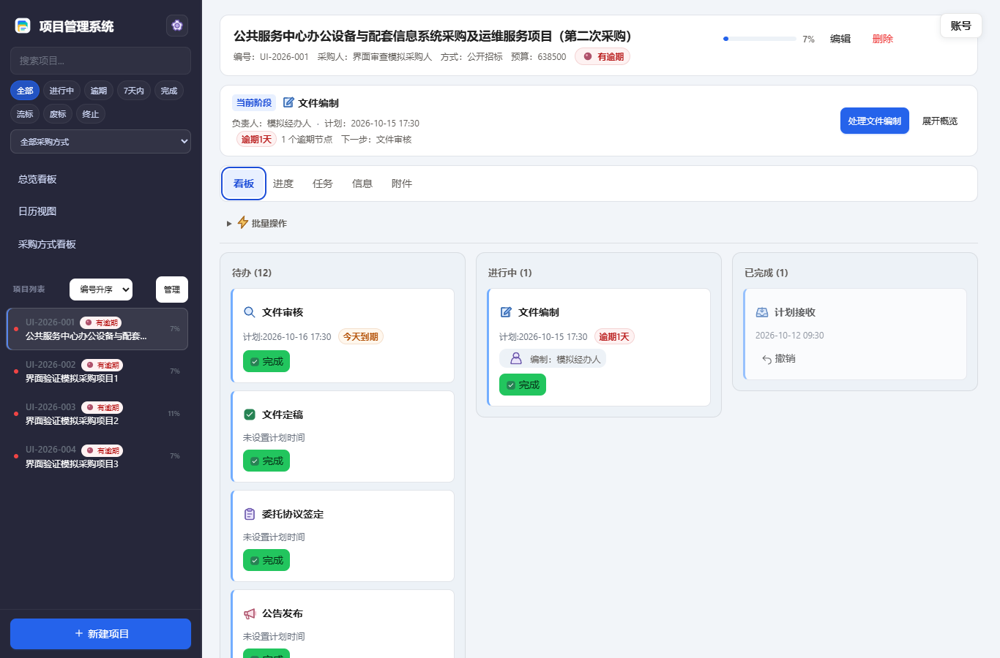

# 招标项目管理系统

Tender Project Management System · Windows 桌面应用

面向招标采购代理机构与内部采购团队，将项目台账、供应商资料、流程节点、保证金和归档资料集中管理。

**[下载完整包](https://github.com/wangmk23/Tender-Project-Management-System/releases/latest) · [使用说明](docs/usage.md) · [功能文档](docs/README.md) · [更新日志](CHANGELOG.md)**

<picture>
  <source media="(prefers-color-scheme: dark)" srcset="docs/screenshots/workspace-v5.8.33-dark.png">
  <source media="(prefers-color-scheme: light)" srcset="docs/screenshots/workspace-v5.8.33-light.png">
  
</picture>

*v5.8.33 界面，截图均使用虚构项目和模拟资料。[查看日期时间选择、手机布局及更多界面](docs/screenshots/README.md)。*

## 下载与使用

当前发布：**[v5.8.39](https://github.com/wangmk23/Tender-Project-Management-System/releases/tag/v5.8.39-public)**。首次使用建议下载完整包，包含系统、两种授权工具与中文使用说明；授权工具任选其一。

| 下载 | 用途 |
| --- | --- |
| [Windows 完整包](https://github.com/wangmk23/Tender-Project-Management-System/releases/download/v5.8.39-public/procurement-project-manager-v5.8.39-public-windows.zip) | 首次部署，解压后先阅读根目录的 `使用说明.txt` |
| [系统程序](https://github.com/wangmk23/Tender-Project-Management-System/releases/download/v5.8.39-public/procurement-project-manager.exe) | 已初始化的公开版部署更新系统程序 |
| [自由运用版授权工具](https://github.com/wangmk23/Tender-Project-Management-System/releases/download/v5.8.39-public/license-issuer.exe) · [绑定磁盘版授权工具](https://github.com/wangmk23/Tender-Project-Management-System/releases/download/v5.8.39-public/license-bound.exe) | 初始化自己的密钥并签发许可证，[了解区别与步骤](docs/usage.md#授权工具界面) |
| [SHA-256 校验文件](https://github.com/wangmk23/Tender-Project-Management-System/releases/download/v5.8.39-public/SHA256SUMS) | 核对下载文件的完整性 |

1. 解压完整包，在授权工具中初始化自己的密钥，设置至少 10 位的私钥密码，并签发本机许可证。
2. 启动系统，使用初始账号 `admin`、密码 `123456` 登录，随后修改密码。
3. 在“项目流程”确认迁移采购方式的适用制度及数量/流程规则，再创建项目。数量默认值不直接等同于法定最低数量。

本版使用与升级边界见[采购方式与界面偏好](docs/procurement-methods.md)。

**已有私有授权部署请使用对应兼容成品。** GitHub 公开包使用自建密钥，不能直接替换原授权部署。升级或迁移步骤见[使用说明](docs/usage.md)。

## 主要功能

| 业务 | 支持内容 |
| --- | --- |
| 项目与采购包 | 按适用制度管理采购方式、项目台账、分包与重新采购、项目检索与统计 |
| 阶段与待办 | 通用/独立默认模板，单项目流程影响预览，数量不足人工确认与历史保护 |
| 供应商与联合体 | 报名登记、成员独立资料、统一附件，以及实际参与、文件接收和有效投标核对 |
| 结果与归档 | 公告链接、中标成交结果、质疑投诉、服务费与资料归档 |
| 保证金管理 | 项目及分包金额、实际缴款核实、全额退还登记、期限规则与复核 |
| 日历与邮件 | 节点日历、国家放假调休安排、保证金期限提醒、收件组分类订阅 |
| 界面偏好 | 四主题及跟随系统、字号与密度、默认首页、侧栏排序字段、日期格式与周起始日 |
| 数据与运行 | 附件管理、Excel 导入导出、备份恢复、账号与设备准入、授权工具 |

系统提供四套主题，阶段日期与时分在同一弹层选择；手机布局优先显示进行中阶段，常用操作支持键盘访问。

竞价功能用于登记外部平台的报价及结果；实际报名、报价交易与评审在相应业务平台完成。保证金功能记录缴退与处理期限，银行转账仍需实际办理后登记。

## v5.8.39 更新

- 采购方式提供“基本设置”和“编辑流程”直接入口，流程采用宽版居中弹窗。
- 左侧展示阶段总览，右侧直接编辑名称、图标和业务模块，切换、排序与新增保留未保存修改。
- 桌面编辑区独立滚动，窄屏上下排列；四主题、键盘选择和只读查看保持一致。

使用方法与数据保护见[流程编辑说明](docs/workflow-editor.md)。完整条目见[发布说明](https://github.com/wangmk23/Tender-Project-Management-System/releases/tag/v5.8.39-public)。

## 文档与反馈

- **开始使用：**[安装与授权](docs/usage.md) · [日常操作](docs/daily-operations.md)
- **业务说明：**[供应商与联合体](docs/consortium-member-profiles.md) · [保证金与节假日日历](docs/tender-guarantee.md) · [邮件提醒](docs/mail-reminders.md)
- **开发维护：**[构建说明](docs/build.md) · [源码与运行时边界](docs/source-boundaries.md) · [贡献指南](.github/CONTRIBUTING.md)
- **更多资料：**[文档导航](docs/README.md) · [界面预览](docs/screenshots/README.md) · [功能审查记录](docs/full-audit-2026-10-16.md)

遇到问题可在 [Issues](https://github.com/wangmk23/Tender-Project-Management-System/issues) 提供版本、复现步骤和脱敏后的截图或日志。请勿上传真实项目资料、数据库、许可证、私钥或邮箱凭据。

## 开放范围与许可

**本产品由 AI 编制。** 仓库公开可编辑的前端、后端扩展、授权工具及构建工具；历史核心后端仍以编译运行时提供，不能仅凭本仓库从零构建完整应用。二次构建需要公开发布的脱敏 Windows 运行时，详见[源码与运行时边界](docs/source-boundaries.md)。

原创代码采用 [MIT License](LICENSE)；第三方库与运行依赖保留各自许可及版权，见[第三方声明](THIRD_PARTY_NOTICES.md)。
