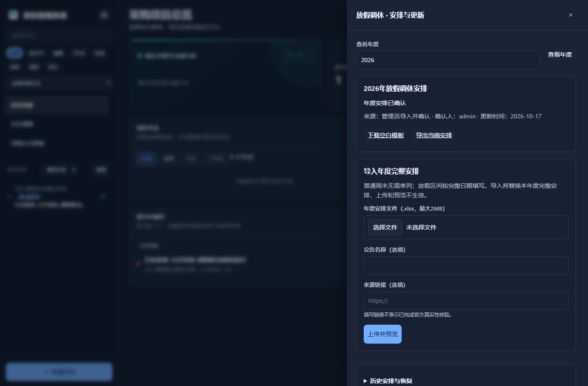
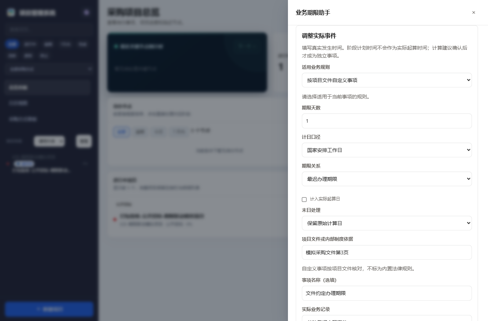

# 年度安排与业务期限

适用于 v5.8.34。放假调休安排由本机管理员核对并导入，不需要为下一年专门更新 EXE。

## 下一年怎样更新

1. 在日历点击“安排与更新”，选择年度，下载空白 `.xlsx` 模板。
2. 阅读“填写说明”，在“放假调休安排”填写该年度完整的放假区间和调休补班。普通周末无需逐一填写；只填写新增假期会遗漏原安排。
3. 按国家发布的年度通知核对内容。上传后先查看逐行错误、日期差异及受影响的保证金和其他期限；来源公告名称与链接可选填。
4. 勾选已核对年度完整安排，再确认更新。仅上传、预览、取消或关闭都不会生效。

| 开始日期 | 结束日期 | 安排 | 节日名称 |
| --- | --- | --- | --- |
| 2027-01-01 | 2027-01-03 | 放假 | 填写通知中的名称 |
| 2027-01-09 | 留空 | 补班 | 填写通知中的名称 |

上表仅解释填写格式，**不是2027年正式放假安排**。结束日期留空表示单日。每份文件只含所选年度，日期重复或“放假/补班”冲突会阻止确认。

可导出当前安排，再按完整年度修订。历史安排可先预览恢复，再确认生成新修订；重复导入相同内容显示“安排未变化”。最初内置安排也会保留为可恢复基线。

系统不抓取来源链接，也不读取或执行表格公式、宏和外部链接。上传限制为 `.xlsx`、2MB，另有限制解压大小和行数。程序可以检查格式、年份、重复和冲突，无法判断是否漏填了真实假期，也不因填写官方链接而认定文件真实。确认导入的来源显示为“管理员导入并确认”。

## 哪些业务共用日历

保证金的国家安排工作日期限、业务期限助手的工作日规则，以及启用“仅国家安排工作日发送”的邮件共用年度日历。补班日计入工作日，放假日排除；自然日规则连续计算。未确认年度不能凭普通周末猜算工作日期限。

年度变化不会自动移动原确认期限。影响预览列出原确认值、新建议和复核状态；新建议已过期时单独提示。是否顺延末日取决于事项规则，不能将所有自然日截止日统一推后。

## 使用期限助手

从项目“信息”或阶段编辑侧栏进入“业务期限助手”。先在“期限适用规则”明确本项目实际适用的制度；系统不会根据采购人名称或采购方式猜测制度。政府采购工程等项目需结合实际适用规则核对。

内置参考事项包括招标/资格预审公告期、招标文件提供期、结果最迟公告、结果公告期、部分非招标公告期、质疑答复、澄清准备时间校验，以及招标投标规则下的候选人公示和异议答复。卡片说明天数、工作日/自然日、起算事实及条文来源。企业自主采购和自定义制度按项目文件登记，不能冒用内置法律规则。

填写真实发生的时间，再计算预览。公告发布、实际收到质疑函、实际确定中标人和实际书面通知是不同事实；澄清发布日期不能替代收到质疑函或书面通知时间。当前可关联质疑和澄清记录；没有对应适配记录的事件需要单独登记实际事实，不能使用阶段计划时间补造。

确认后的事项独立保存，一个阶段可有多项期限，多条质疑和澄清按原记录分别关联。仅日期表示当天结束；含时分的记录按北京时间精确判断。澄清最小间隔同时填写实际书面通知与提交截止，计算不足时不能确认有效间隔。

仍有适用或末日口径待核对的有效建议，可以“保存待核对事项”；填写核对依据并明确采用后才建立正式期限。起算事实或日历缺失时不能直接确认。

“同步为所选阶段计划时间”新增时默认不选；明确勾选后才同步。期限到期与业务办结分别记录，不会据此自动发布公告、退款或完成阶段。编辑中打开助手再返回，会保留未保存的阶段字段和焦点。

## 复核、日历与邮件

原事实、制度、采购包或依赖日历发生变化时，事项保留原确认期限并标为需复核。可以采用新建议、说明原因保留原期限，或登记尚需核实。已办结、已取消记录保留历史，不会自动重开。修改原记录采购包后必须重新核对事项关联。

日历事项直接打开对应期限的处理侧栏，展示原期限和新建议。收件组新增“业务期限提醒”和“期限变更复核”，需要主动订阅；不会自动扩大原邮箱的订阅范围。确认期限需要复核时，原期限仍继续提醒。登记已办结或取消后，尚未发送的相关排队邮件取消。

只有明确同步到同一阶段、同一确认时间，且同一收件人订阅相应期限提醒时，才合并重复阶段提醒；不同义务不因同日就被合并。邮件发送仍受总开关、收件组、发件配置及发送日安排控制。

## 历史数据与验证边界

升级前项目默认关闭期限助手，不回填历史事项，不改变原阶段、结果、缴退款记录、密钥、许可证或邮件凭据。启用“作为新项目默认”只应用于之后创建的项目。

本次验证采用隔离模拟数据和无头浏览器；没有发送真实业务邮件，也没有替换或重启现有运行程序。条文卡片提供参考计算与来源，不代替经办人对具体制度、起算事实和末日口径的核对。此前实际电脑报名自动完成逾期个案仍按要求暂缓，本次更新不代表该个案已解决。

具体成品检查见[本版验证记录](calendar-deadlines-verification.md)。
