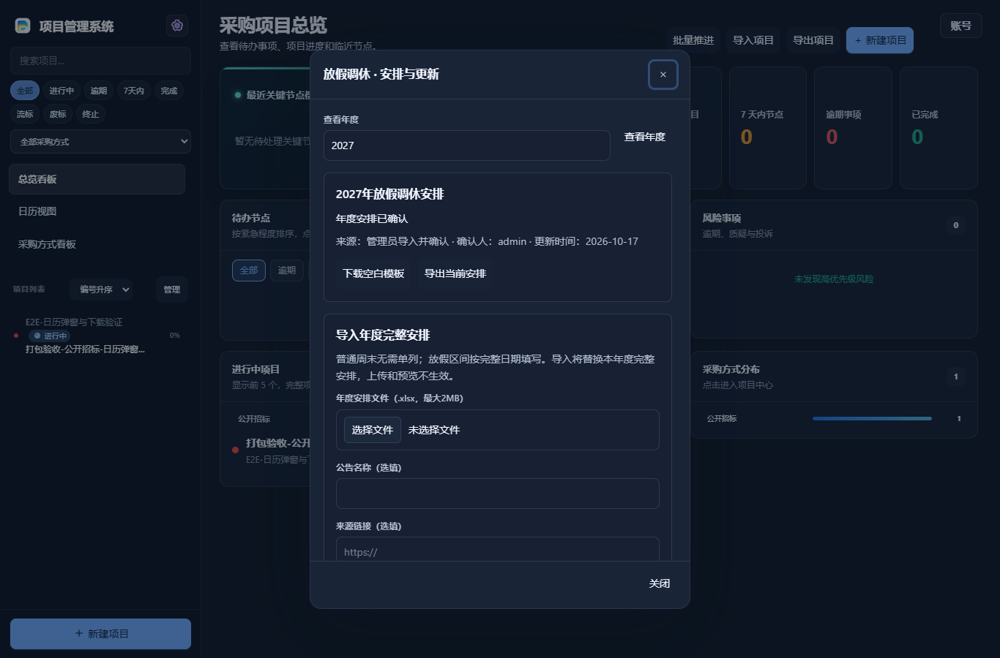

# v5.8.35 日历弹窗与模板下载修复

## 原因与改动

v5.8.34 新增的年度模板与导出按钮是普通下载链接，后端只返回XLSX附件，没有接入客户端原有的“文件保存位置”。因此HTTP能返回文件不代表客户端已将文件保存到指定目录。

“安排与更新”恢复共享主题弹窗，底部固定关闭按钮；原阶段侧栏与未保存字段保留。客户端下载和导出改为带CSRF的本机保存请求，使用原有目录设置，结果在弹窗内显示完整路径。浏览器仍按浏览器下载位置保存。重复下载使用独占创建的不同文件名；写入失败清理本次不完整文件，保留原文件和待导入草稿。

## 已验证

- 实际兼容EXE的50项专项检查通过：点击客户端模板按钮、指定目录写入、重复下载不覆盖、完整路径反馈、浏览器下载文件名与宿主目录不变、填写已下载模板、上传预览不生效、明确确认、重新导出往返、四主题1366/390宽度、关闭/键盘操作、未保存阶段内容和重启保留。
- 原年度安排与独立期限联动65项成品回归通过，包含v5.8.34数据副本升级。
- Python851项运行（827通过、24项环境跳过）、前端426项通过，公开版自建密钥首次运行15组通过；界面沿用UI UX Pro Max与Taste Redesign所要求的主题一致性、键盘、滚动与反馈检查。

## 验证边界

客户端保存分支使用真实打包EXE和隔离数据，在无头Chromium中点击；浏览器下载分支在同一真实服务上明确切换前端模式后验证，没有冒充已在原生WebView或所有浏览器中人工验收。未在所有Excel/WPS版本中手工填写；实际下载模板经过修改、上传、确认及导出解析的往返测试。

现有运行程序、数据库、附件、授权、密钥和邮件凭据未修改，未发送真实邮件。仅恢复日历“安排与更新”弹窗，独立业务期限助手的侧栏保持原样。
