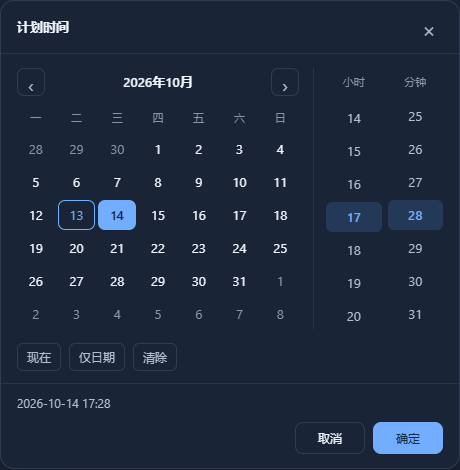

# 日期与时分在同一弹层选择

v5.8.24 点击阶段时间控件后，在一个面板内同时显示月历、小时和分钟列表。选择不再打开浏览器自带的两种弹窗，面板颜色、边框、选中状态和按钮跟随系统的明暗主题。

选择日期、小时、分钟后点击“确定”，系统一次提交两个值。“取消”、关闭按钮、Escape 或点击面板外侧均放弃本次选择。仅有日期的历史记录仍可保存为“仅日期”，未改动的计划保留原有秒和小数秒精度。

覆盖阶段计划与完成时间、快速完成、按阶段或按项目批量推进，以及批量计划的逐阶段设置和快速填充起始时间。新增弹层接入应用焦点管理，支持方向键、Tab 与 Escape；窄屏与短窗口限制在可见区域内，减少动画偏好关闭入场动画。

## 验证与边界

前端302项与相关Python88项回归通过；最终兼容EXE的实际HTTP页面10项通过。公开首次使用13项通过，最终公开成品与该候选的后台和授权字节相同，后续差异仅为前端脚本及样式。

浏览器回归覆盖日期与时分同时展示、一次保存、取消、闰日、仅日期记录、清除、禁用状态、动态批量表单、键盘与焦点、短窗口、表单替换和过期草稿。额外使用实际应用的弹窗焦点管理复现并修复父弹窗抢走选择器焦点的问题。实际候选 EXE 的 HTTP 页面验证使用隔离数据，不代表人工桌面验收。

本版只调整时间选择交互，不改变业务完成规则、报名处理或授权方式。授权工具沿用 1.8。报名逾期个案的排查已按要求暂缓，不能将日期弹层更新写成该个案已修复。
