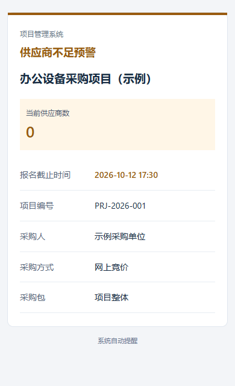

# 邮件正文版式

每日阶段提醒、项目新建、项目完成和供应商不足预警共用一套 HTML 邮件布局，保留纯文本备用正文。

提醒标题位于顶部，项目名称按所选内容字段显示。已选择的供应商人数、最低要求及缺少数量在摘要区展示，截止时间加粗，其余资料使用固定宽度标签和分隔线。供应商不足预警使用琥珀色，完成提醒使用绿色，其他提醒使用蓝色。

只展示收件组选择的字段，摘要不会补出被隐藏的人数、项目名称或截止时间。所有动态值经过 HTML 转义，不载入外部图片、字体或脚本。提醒条件、收件人、主题及发送时间不因版式调整改变。

验证覆盖四类邮件与仅选部分字段的预览，在 320、390 和 760 像素宽度下检查页面溢出和标签换行，共 15 项浏览器检查。邮件回归及实际成品邮件代码分别运行 139 项测试，包含隐藏字段、零人数、HTML 注入与纯文本备用正文。

预览采用无头浏览器及虚构数据，不等同于实际邮箱客户端验收。邮件客户端可能重新处理字体、深色模式、圆角和日期链接；基本资料表格与纯文本正文仍可阅读。本次不发送真实邮件，不修改正式项目或邮箱配置，也不自动重启运行中的系统。
