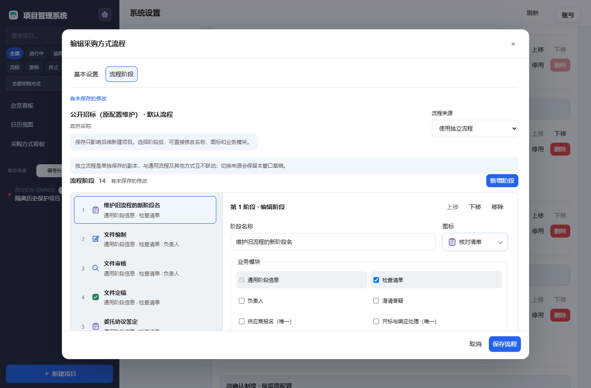
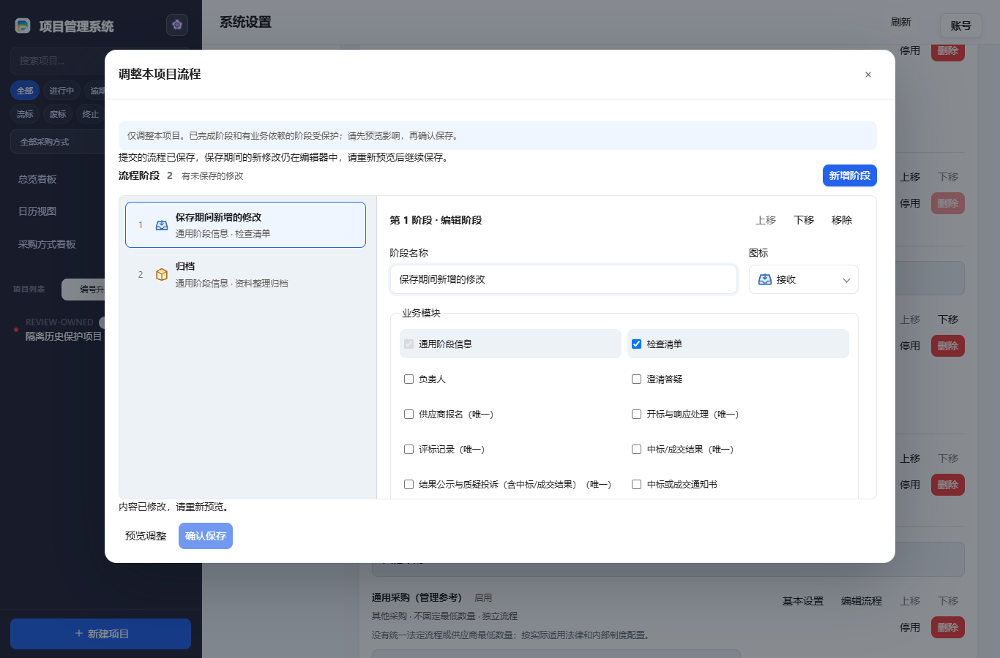

# 采购方式审查修复（v5.8.40）

## 保存与离开窗口

每次保存绑定发起它的表单实例和采购方式标识。保存A期间离开后打开B，A的响应不能修改B的内部标识、内容或错误提示。离开正在保存的窗口会明确提示：已发出的请求不会被撤销；尚未提交的修改会被放弃。

方法、通用模板和项目流程保存期间继续输入，新草稿会保留。项目流程需要重新预览再保存，以获取当前数据库的影响与版本指纹；窗口不会把后来输入当成已保存内容直接关闭。

## 维护旧方式与分类冲突

“待确认制度”表示旧方式缺少制度分类，原流程仍保留。可先维护旧流程和原设置，无需强制补制度；未确认的方式仍不能用于新建项目。新方式或已分类方式的制度必填，错误会切到基本设置并定位字段。

为旧方式选择制度时，若同制度已有同名方式，会提前显示冲突及流程对比。可以主动修改当前方式名称，或点击“保留待确认并维护旧流程”。如需处理现有项，应另行在列表手动更名或删除，删除继续受引用保护；仅停用不会消除同名冲突。系统不隐式改名、合并、覆盖或迁移项目。

## 标题、图标与流程关系

流程标题同步显示当前名称、制度及未保存状态。图标下拉框使用和阶段列表相同的SVG与文字名称；键盘操作和存储值保持。

通用流程是共享模板，说明中可展开查看使用它的方式；更新后影响这些方式后续新建项目。独立流程是单独保存的副本，互不联动。切换来源保留本窗口的独立草稿。当前仍只有一套通用流程和各方式的独立流程，没有新增多个可命名共享模板。

## 验证

前端458项通过；Python932项运行（908通过、24环境跳过）。最终兼容EXE的升级基线89项及定向操作24项通过，公开首次运行17项通过，浏览器脚本错误0。覆盖延迟保存跨窗口、继续输入、旧流程维护、分类冲突及手动解决、标题与SVG键盘选择、历史项目对比和重启持久化；四主题及1366/900/390宽度验证。

所有运行使用隔离虚构数据及复制的隔离许可夹具，未读取生产数据库或发送真实邮件；未人工验收原生桌面WebView，也不将本专项称为全系统全部功能的最终验收。

## 成品界面（隔离虚构数据）

