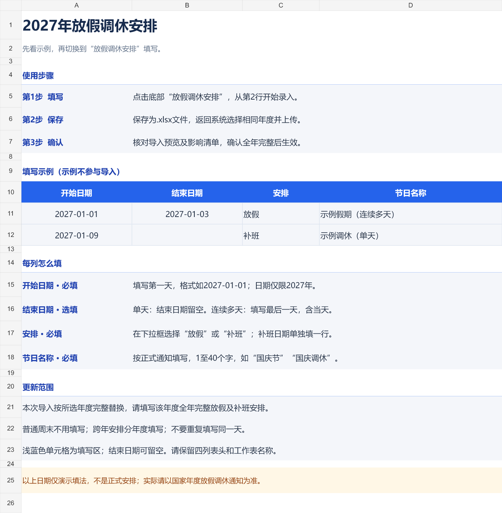
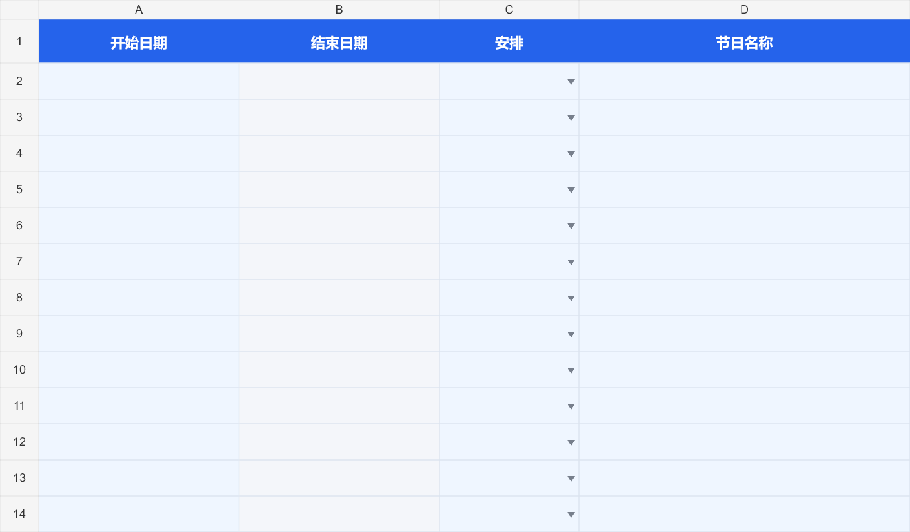

# 节假日 Excel 模板

v5.8.36 重新排版年度安排模板与当前安排导出。下载位置与 v5.8.35 相同：客户端保存到设置中的文件保存位置，并显示完整路径；浏览器使用浏览器的下载位置。

## 填写步骤

1. 在日历“安排与更新”中选好年度，下载模板。
2. 打开后先看“填写说明”，其中的两行示例分别演示连续放假和单天补班。
3. 切换到底部的“放假调休安排”，从第2行开始填写。浅蓝色为填写区，灰色结束日期为选填。
4. 保存为 `.xlsx`，在系统选择同一年度并上传，检查预览及业务影响清单，再确认生效。

| 列 | 填法 |
| --- | --- |
| 开始日期 | 必填，输入所选年度内的日期，例如 `2027-01-01` |
| 结束日期 | 单天留空；连续多天填写最后一天，包含该日 |
| 安排 | 在下拉框选择“放假”或“补班” |
| 节日名称 | 必填，按正式通知填写1至40个字 |

示例日期只演示格式，不是该年度正式安排。示例位于说明页，不参与导入；实际填写页保持空白，上传空模板会提示补充年度安排。

一次导入完整替换所选年度的放假及补班安排。请填全年完整内容，普通周末不用列入；跨年安排分年度填写，不要重复列入同一天。请保留工作表名称和四列表头。旧模板仍可使用。

输入格提供填写提示。日期校验限定所选年度，“安排”提供下拉选项，节日名称限制长度。粘贴等操作可能绕过表格软件的输入校验，系统上传后仍会逐行检查，不以表格内提示代替服务端校验。

## 验证记录与边界

- 27项年度模板与导入专项通过：空白模板不会导入示例；当前安排导出往返保留日期、补班及字面文本；旧模板、Excel日期系统、重复日期及不合法文件继续校验。
- 实际兼容EXE的50项弹窗、客户端下载到指定目录、重复下载、浏览器分支、填写文件上传、确认、重新导出和重启保留检查通过，浏览器脚本错误为0。此次上传使用表格工具编辑后保存的文件，覆盖ISO零点日期和结束日期留空。
- 从实际EXE下载的工作簿由Artifact Tool读取并渲染，已查看说明页和填写页；表格工具填写、重算、保存后能导入。没有新增运行时表格依赖。
- Python854项运行，830通过、24项因环境跳过；公开版自建密钥首次运行15项通过。前端回归结果随交付记录保存。

ISO日期单元格的零点形式可表示纯日期；具体时分、非零时区偏移、带小数时间的日期仍拒绝，避免静默改写日期。没有放宽宏、公式、外链及压缩包安全校验。

成品操作在隔离数据和无头Chromium中完成，浏览器分支经过显式切换；未声称在原生WebView及全部Excel/WPS版本人工验收。没有替换或重启原程序，没有改动原数据库、附件、授权、密钥和邮件配置，没有发送真实邮件。
