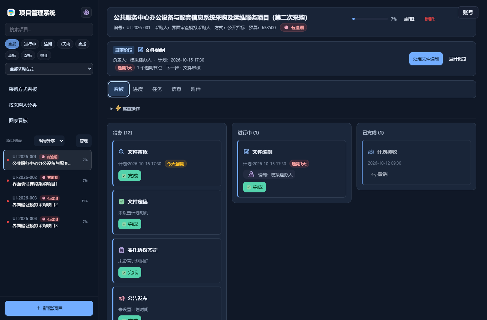
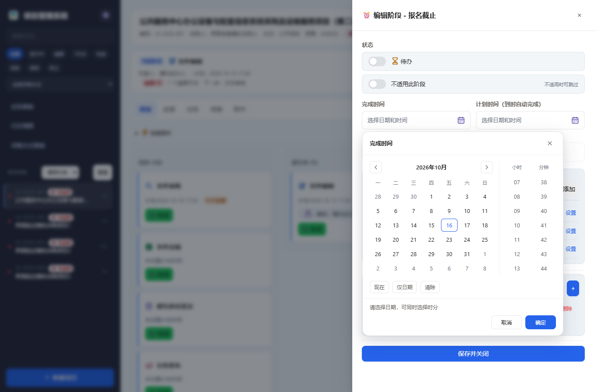
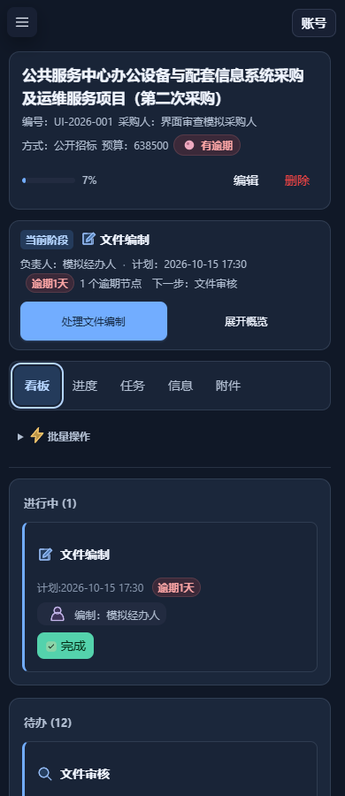

# 界面预览

[返回项目首页](../../README.md) · [文档导航](../README.md)

以下四张截图来自 v5.8.33 成品的隔离验证，均使用虚构项目和模拟资料，不包含真实业务数据。主题会影响配色，浏览器宽度会影响布局。

## 项目工作区 · 浅色

当前阶段、负责人及下一步集中展示，批量操作按需展开。

## 项目工作区 · 深色

相同业务布局适配深色主题，保留阶段彩色图标与状态文字。

## 日期与时间

在同一个弹层选择日期、小时和分钟。

## 窄屏布局

窄屏优先显示进行中阶段，导航按需展开。

## 授权中心

授权工具 1.8 沿用以下三页布局。此图为 1.7 版原生控件渲染，供布局参考；操作步骤见[使用说明](../usage.md#授权工具界面)。

## 图标

阶段、状态、附件与设置使用项目自绘彩色矢量图标。

