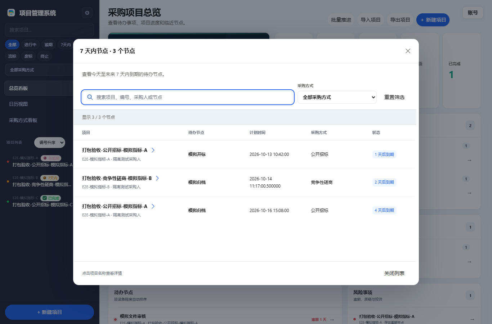
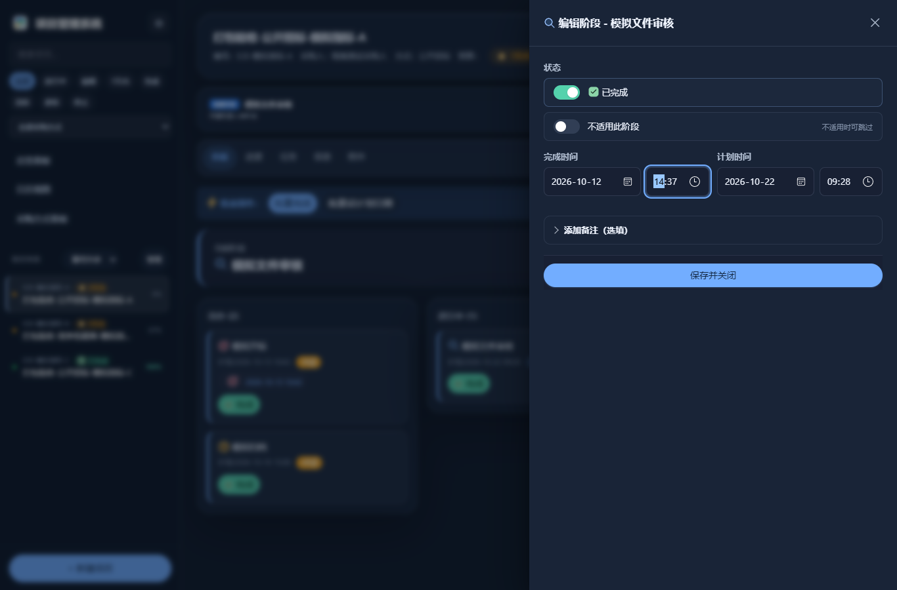

# 阶段时间与总览列表

以下为实际候选 EXE 的无头浏览器截图，使用隔离虚构项目，不是用户业务桌面。

## 填写阶段时间

阶段编辑中的计划时间和完成时间分别由日期、时分两个输入框组成，时分精确到分钟。快速完成、批量完成、按阶段批量推进和批量设置计划也使用相同的时间精度。看板、进度和任务列表显示保存后的时分。

历史完成记录只保存了日期时，继续显示原日期，时分可以留空，无需重新填写。修改备注、负责人或其他资料不会补入虚构的完成时刻。已有计划时间含秒或小数秒时，未修改日期和分钟的保存保留原值；主动调整时分后按新分钟保存。撤销阶段完成会同时清除完成日期和时分。

完成时间沿用本机本地时间，数据库扩展列 `completed_at` 保存阶段分钟，原 `completed_date` 日期列继续保留。首次打开旧数据库会增加可空扩展列，不改写历史完成日期。无效时间、日期冲突和跨项目阶段操作会被拒绝；保存失败时事务回滚。

## 查看总览明细

点击“进行中”“未开标项目”“7 天内节点”“逾期事项”或“已完成”，会在总览上打开独立列表面板。列表支持按项目名称、编号、采购人搜索，以及按采购方式筛选；节点列表也支持搜索节点名称和计划时间。重置筛选恢复完整列表，关闭后保留总览位置。

“进行中”“未开标项目”“已完成”以项目计数；“7 天内节点”和“逾期事项”以节点或事项计数，同一项目有多个待办节点时会出现多行。卡片和列表使用同一数据集合。已移除、已完成、不适用阶段以及已终止项目不进入待办节点列表。点击项目名称才进入项目详情。

列表适配明暗主题，桌面使用表格，窄屏使用逐条资料布局。列表内容单独滚动，筛选和关闭操作保持可见。

## 加载反馈

首次读取项目详情时显示自绘旋转图标。提示保留到请求结束，成功、失败或切换项目后清理本次加载状态；旧请求结束不会关闭后续提示。减少动画偏好下显示静态图标。普通信息提示与问号帮助图标分别绘制。

## 验证范围

源码回归覆盖分钟输入、保存与撤销、历史时间保留、自动完成事务、五类列表集合与筛选、加载提示生命周期。成品验证使用复制的许可证和独立临时数据库，覆盖旧库迁移、保存后重启及 SQLCipher 数据库快照恢复。浏览器检查使用实际候选 EXE 的 HTTP 页面与虚构项目，检查明暗主题、桌面和窄屏布局。

无头浏览器截图不等同于人工操作真实桌面；数据库快照恢复不等同于完整备份包恢复。验证不写正式业务数据、不发送真实邮件、不重启用户运行中的程序。具体计数、候选哈希和证据保存在本地交付记录。

实际成品复核还修复了自定义阶段保存响应缺项的问题：保存接口返回模板快照中的自定义阶段，编辑面板可立即同步时间和资料。

v5.8.21 交付验证：前端 288 项通过；开启哈希固定的成品检查后，Python 707 项中 706 项通过、1 项因 Windows 无符号链接创建权限跳过，无失败。另有实际兼容 EXE 时间与迁移 16 项、无头界面 8 项、公开版首次运行 13 项及公开版业务 20 组通过。界面覆盖明暗主题的 1366 和 390 像素宽度。
