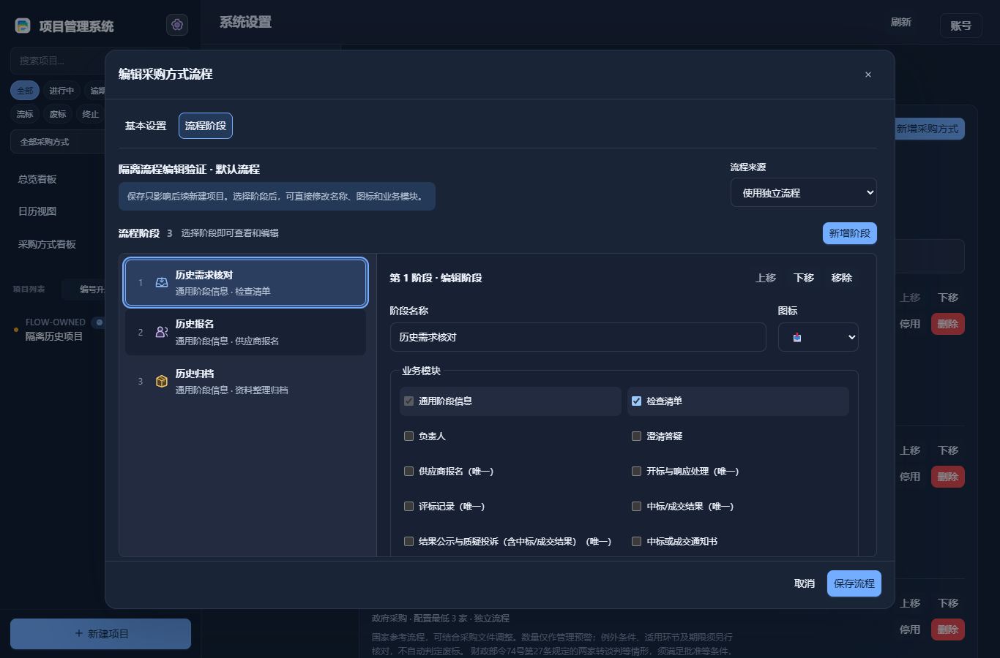

# 流程阶段编辑（v5.8.39）

在“系统设置 → 项目流程”找到采购方式，点击“编辑流程”；“基本设置”用于方式名称、制度、供应商数量、例外及备注，两类内容可在同一弹窗切换，草稿不会丢失。

流程以居中宽弹窗显示。左侧按顺序展示阶段，点击即可在右侧直接编辑名称、图标和业务模块。新增后选中新阶段；上移、下移后继续编辑原选中阶段。名称即时反映到左侧列表。右侧可独立滚动，阶段总览保持可见；窄屏上下排列，底部保留保存与取消。

通用流程先以只读列表展示。需要仅修改该方式时，点击“改为独立流程并编辑”；复制后的修改不改写通用模板。采购方式、通用流程与单项目流程使用相同的阶段编辑器。切换阶段不算业务修改；有未保存修改时关闭会询问是否放弃。非管理员可以查看和切换内容，不能修改配置。

点击“保存流程”提交当前采购方式的草稿，包括在基本设置中尚未保存的内容。保存冲突保留当前草稿。保存期间继续输入的修改保留在编辑器中，并提示再次保存。

默认模板只影响后续新建项目，不自动改写历史记录。单项目仍通过“调整本项目流程”先预览再确认保存，已完成阶段、已有业务资料及规则依赖继续受保护；预览期间修改流程，需重新预览。

## 验证范围

前端446项通过，Python931项运行（907通过、24环境跳过）。实际v5.8.38→v5.8.39兼容EXE升级89项检查、公开首次运行17项通过。检查四主题及1366、900、390宽度、键盘操作、保存与重启、历史项目保持和完成保护。原生WebView没有人工验收，未发送真实邮件。
